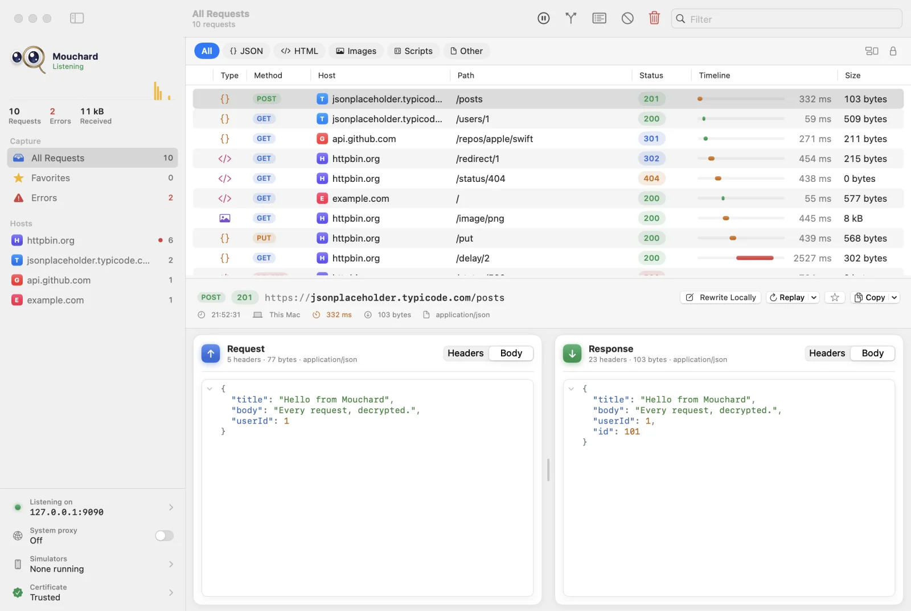

  

<h1 align="center">Mouchard</h1>

  A minimal native macOS HTTP/HTTPS debugging proxy. 
  See every request and response of your Mac, your iPhone and your simulators, decrypted.

  

  
  
  
  

  <picture>
    <source srcset=".github/assets/main-dark.webp" media="(prefers-color-scheme: dark)">
    
  </picture>

---

## Highlights

- 🔐 **HTTPS decryption**, with automatic detection of certificate pinning
- 📱 **iPhone and Xcode simulators**: install the certificate with a QR code or in one click
- 🔍 **Inspector** with colorized, foldable JSON, WebSockets, image and HTML previews
- 💡 **Clues** at a glance: JWTs decoded, redirects, CORS, cache, slow or large responses
- 🔁 **Replay** and **Edit and Replay** of any request
- 🧭 **Map Remote**, **Map Local**, **header rewriting** and **blocking**
- 📦 **HAR** import and export
- 🌍 English and French

## Install

1. Download [**Mouchard.dmg**](https://github.com/mouchard-app/releases/releases/latest/download/Mouchard.dmg).
2. Open it and drag **Mouchard** into **Applications**.
3. Launch it and enter your access code.

Mouchard keeps itself up to date: new versions are published here and installed through Sparkle, with their signature verified.

> [!NOTE]
> Mouchard is in **private beta**: the app asks for an access code on first launch.

## About this repository

This repository only hosts the release builds of Mouchard. Everything else is on **[mouchard.app](https://mouchard.app)**.
